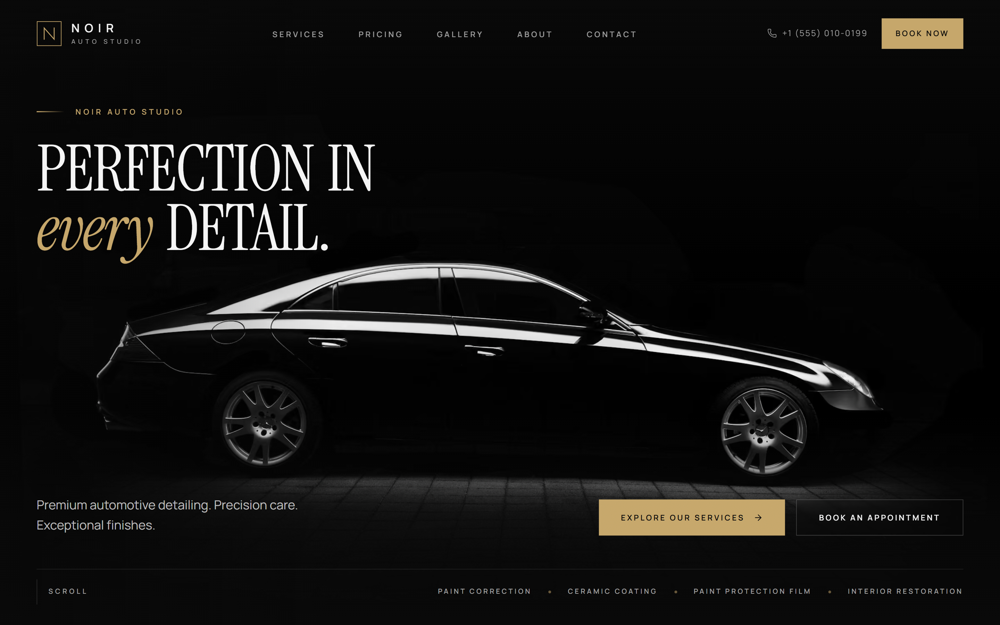
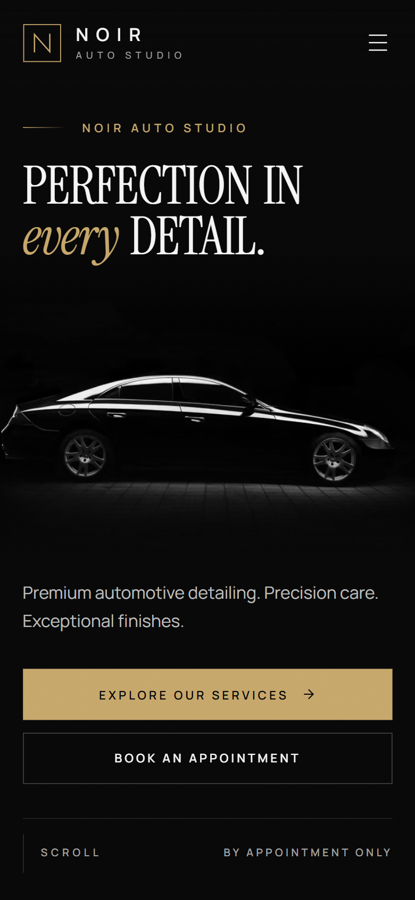
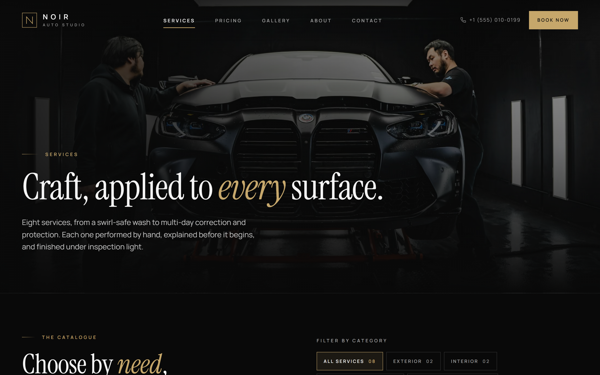
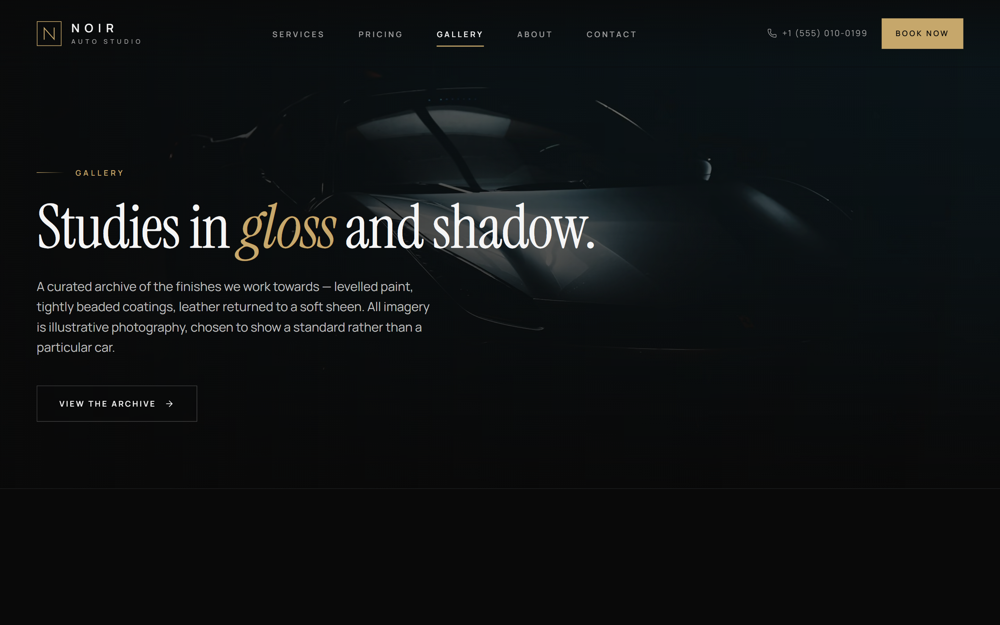
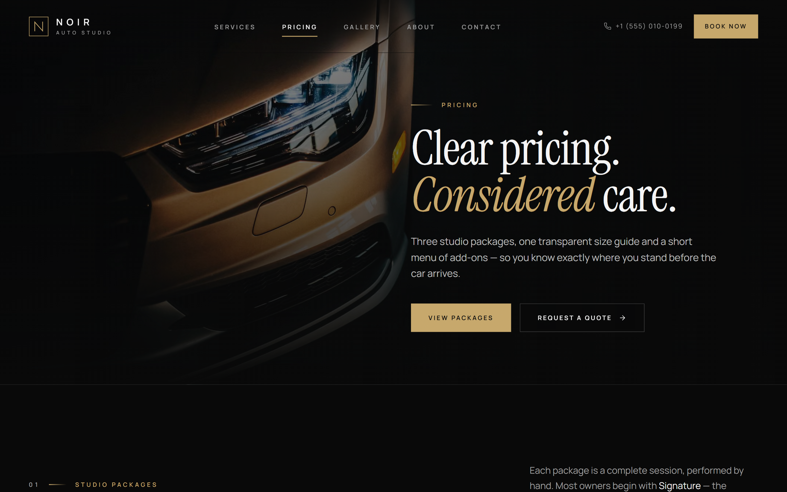
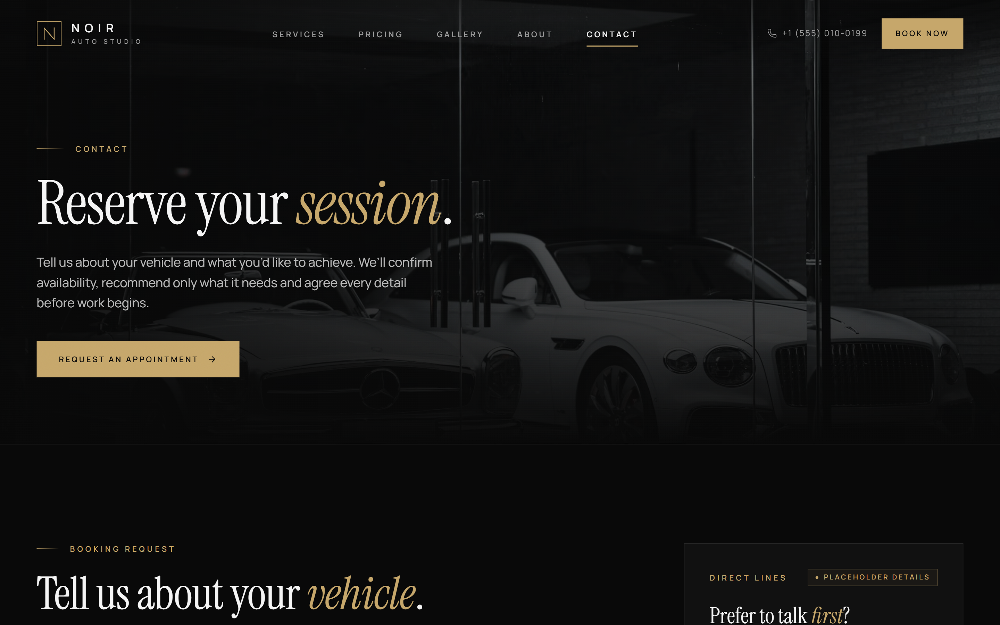

# NOIR AUTO STUDIO

A responsive multi-page marketing website for **Noir Auto Studio**, a *fictional* automotive detailing studio,
built with Next.js, React and TypeScript as a web-development portfolio project.

## Project Overview

The site presents a luxury detailing studio across seven routes: home, services, pricing, gallery, about,
contact and photo credits. It demonstrates a design-system-driven UI, a typed content layer, accessible
interactive components (lightbox, filters, accordion, mobile menu, slider) and a validated booking form.

> **This is a demonstration project.** The business, prices, durations, testimonials, contact details,
> opening hours and map are fictional and labelled as such on the site. See [Known Limitations](#known-limitations).

## Project Preview

Screenshots live in [`docs/screenshots/`](docs/screenshots/). They have not been added yet; once the files
exist, the images below will render.

| Homepage (desktop) | Homepage (mobile) |
| --- | --- |
|  |  |

| Services | Gallery |
| --- | --- |
|  |  |

| Pricing | Contact |
| --- | --- |
|  |  |

## Live Demo

**Live demo:** _coming soon_ (placeholder for the future Vercel deployment URL).

## Key Features

| Page | Highlights |
| --- | --- |
| **Home** (`/`) | Full-viewport hero, brand intro, service cards, "why choose us" section, before/after slider, featured-work mosaic, demo testimonials, closing call to action |
| **Services** (`/services`) | Category filter with live result count, jump list, eight service entries (image, description, inclusions, estimated duration, starting price), booking links that pre-select the service, process timeline |
| **Pricing** (`/pricing`) | Three packages, price disclaimer, vehicle size guide, interactive price estimator, comparison table, add-ons, FAQ accordion with FAQPage JSON-LD |
| **Gallery** (`/gallery`) | 23 photos in a masonry grid, category filters, full-screen lightbox (focus trap, keyboard and swipe navigation, credits) |
| **About** (`/about`) | Brand philosophy, principles, quality standards, interactive inspection-light demo |
| **Contact** (`/contact`) | Booking form (React Hook Form + Zod) with inline errors and success/error states, placeholder contact links, demo opening hours, stylised map |
| **Credits** (`/credits`) | Photographer credits, typefaces and icon licences |

Site-wide: sticky header that hides on scroll-down, accessible mobile menu, skip link, footer, custom 404 and
error pages, favicon, Apple touch icon and generated Open Graph image.

## Technologies Used

| Area | Technology |
| --- | --- |
| Framework | Next.js 16.4 (App Router, Turbopack, Cache Components) |
| UI library | React 19.3 |
| Language | TypeScript 5 (strict) |
| Styling | Tailwind CSS 4.3 (design tokens in `src/app/globals.css`) |
| Animation | Motion 14 (`motion/react`), respects `prefers-reduced-motion` |
| Forms and validation | React Hook Form 7, Zod 4, `@hookform/resolvers` |
| Icons and utilities | Lucide React, `clsx`, `tailwind-merge` |
| Fonts | Instrument Serif and Manrope via `next/font` |
| Tooling | ESLint 10 with `eslint-config-next` |

## Project Architecture

- **App Router, static output.** Every route is prerendered at build time; there is no server-side API.
- **Content separated from presentation.** Services, pricing, testimonials, gallery and the typed photo
  registry (with alt text and credits) live in `src/data/`; components only render them.
- **Section-based components.** Each page is composed of section components under `src/components/sections/`
  built from shared primitives in `src/components/ui/`.
- **Validation schema shared with the form.** `src/lib/validations.ts` defines the Zod contact schema used by
  the form through React Hook Form.
- **Local assets.** All photography is stored in `src/assets/images/` and served through `next/image`.

## Project Structure

```
src/
├── app/                  # routes, metadata files (sitemap, robots, OG image, icons), global styles
├── assets/images/        # locally stored photography (home, services, gallery, about, pages)
├── components/
│   ├── layout/           # Header, Footer
│   ├── ui/               # Button, SectionHeading, Reveal, cards, FAQ accordion, ...
│   ├── sections/         # page sections (home, services, pricing, about, contact)
│   ├── gallery/          # GalleryGrid, Lightbox, FinishGuide
│   └── forms/            # ContactForm, FormField, skeleton
├── data/                 # typed content: images, services, pricing, testimonials, gallery
├── lib/                  # site config, validation schema, booking helper, hooks, utilities
└── types/                # shared domain types
docs/screenshots/         # README screenshots
CREDITS.md                # full per-photo attribution
```

## Responsive Design

The layout was built mobile-first with Tailwind breakpoints. The comparison table scrolls inside its own
container on narrow screens, the gallery column count adapts to the viewport, and navigation switches to a
full-screen mobile menu. The site was checked at 360, 390, 768, 1024, 1440 and 1920 px widths with no
horizontal overflow.

## Accessibility

- Semantic landmarks, one `h1` per page, logical heading order, skip link.
- Visible focus rings; keyboard-operable slider, filters, accordion, menu and lightbox.
- Labelled form controls; errors linked with `aria-invalid` / `aria-describedby` and announced via `role="alert"`.
- Focus-trapped dialogs (mobile menu, lightbox), Esc to close, scroll lock.
- 44 px touch targets and `prefers-reduced-motion` support.

An automated axe-core run (WCAG 2.2 AA) reported no violations on any page at desktop and mobile widths.
Automated checks do not replace manual testing with assistive technology.

## SEO

| Item | Implementation |
| --- | --- |
| Metadata | Per-page title, description and canonical URL |
| Social | Open Graph data and a generated Open Graph image |
| Crawling | `sitemap.xml` and `robots.txt` generated from code |
| Structured data | FAQPage JSON-LD on `/pricing` |
| Images | Descriptive alt text from the typed photo registry |

Set `NEXT_PUBLIC_SITE_URL` to the deployed origin so canonical URLs and the sitemap use the real domain.

## Installation Instructions

**Requirements:** Node.js 20.9 or newer and npm.

```bash
git clone <repository-url>
cd noir-auto-studio
npm install
```

### Configuration

No environment variables are required. One optional variable is supported:

| Variable | Purpose | Default |
| --- | --- | --- |
| `NEXT_PUBLIC_SITE_URL` | Absolute site URL for canonical URLs, Open Graph, sitemap and robots | `https://noir-auto-studio.example` |

## Local Development

```bash
npm run dev          # dev server at http://localhost:3000
npm run typecheck    # TypeScript, no emit
npm run lint         # ESLint
```

## Production Build

```bash
npm run check        # typecheck + lint + build
npm run build        # production build only
npm run start        # serve the production build at http://localhost:3000
```

## Credits

- **Photography:** all photographs are from [Unsplash](https://unsplash.com) and used under the
  [Unsplash License](https://unsplash.com/license). Every photographer, source link and image description is
  listed in [CREDITS.md](CREDITS.md) and on the site's `/credits` page. Brand names visible on photographed
  vehicles belong to their owners.
- **Typefaces:** Instrument Serif and Manrope, SIL Open Font License 1.1.
- **Icons:** [Lucide](https://lucide.dev), ISC License.

## Known Limitations

- **The contact form does not send real requests.** It validates input and simulates a submission in the
  browser; nothing is emailed, stored or sent to a backend.
- **Photographs are illustrative.** They are stock images, not work by a real studio or real client results.
- **The map is stylised.** It is a static inline SVG placeholder, not an interactive or real map.
- **The before/after slider is a CSS imitation.** The "before" state is simulated with CSS over a single
  photo, not a real before/after photo pair.
- **Contact data and content are fictional:** phone numbers use the 555-01xx range, email and site use the
  reserved `.example` domain, and prices, durations and testimonials are demo content.
- English only; no CMS (content lives in `src/data/`).
- `npm audit` reports moderate advisories in ESLint's dev-only dependency chain; nothing ships to the browser.
